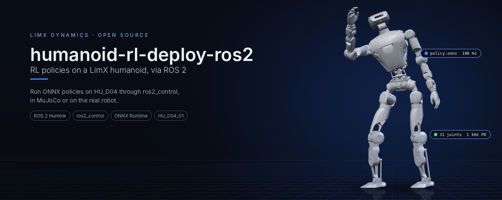
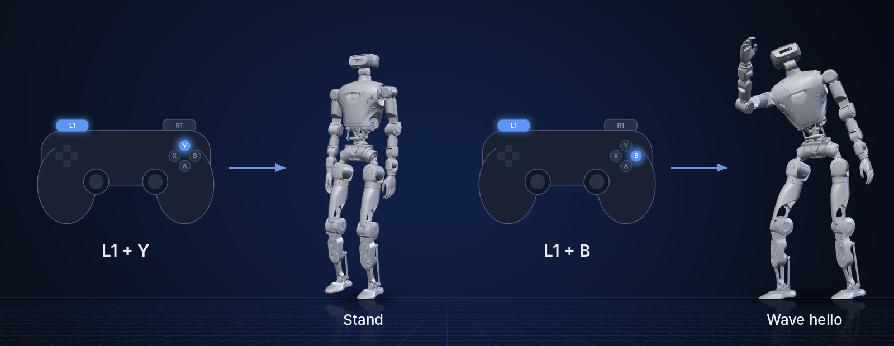
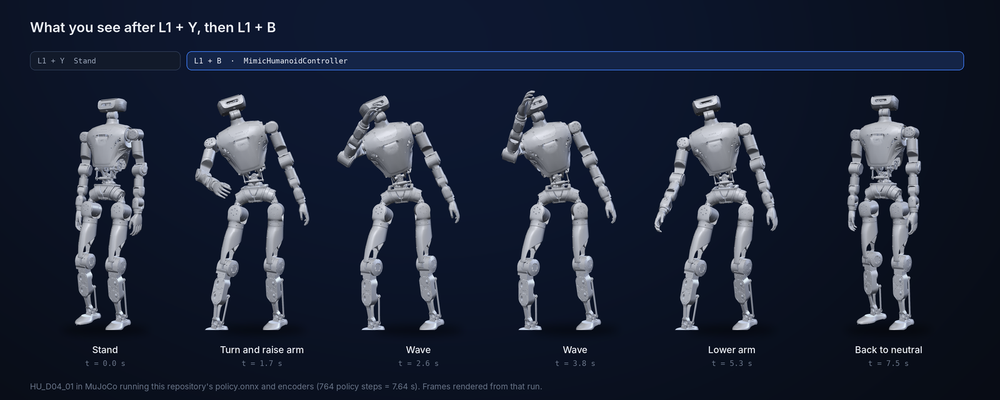
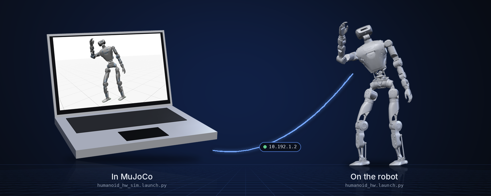
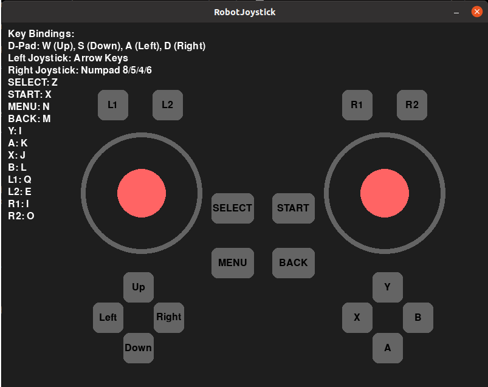

<p align="center">
  
</p>

<p align="center">
  <b>English</b> | <a href="README_cn.md">中文</a>
</p>

<p align="center">
  <a href="LICENSE"></a>
  
  
  
</p>

# humanoid-rl-deploy-ros2

Deploy reinforcement-learning policies on the LimX humanoid with ROS 2 and
`ros2_control`: the same build runs in the MuJoCo simulator and on the real
robot, and the remote controller switches between standing and the policy.

> **Scope:** the ROS 2 deployment side. It ships a hardware node, three
> controllers and one example policy (a greeting motion) as ONNX files. Policy
> training is not part of this repository; the simulator is
> [humanoid-mujoco-sim](https://github.com/limxdynamics/humanoid-mujoco-sim).

## Highlights

- **Sim and real from one build.** Two launch files that differ only in the
  robot address: `127.0.0.1` for MuJoCo, `10.192.1.2` for the robot.
- **ONNX policy, no Python at runtime.** C++ inference with ONNX Runtime: a
  policy plus two encoders, run at 100 Hz inside a 1 kHz control loop.
- **Controllers on the remote.** `L1 + Y` stands up, `L1 + B` plays the policy,
  `L1 + A` switches to damping.
- **Safety clamps in the controller.** Every joint target is clipped so the PD
  torque stays within 95% of a per-joint torque limit.
- **Standard `ros2_control` plugins.** Controllers load through pluginlib, so a
  new controller is one more class and one more line in the config.

## Supported robots

| | Model | Description | DoF | Format |
|:-:|---|---|:-:|---|
|  | `HU_D04_01` | Full-size humanoid: legs, 3-DoF waist, 2-DoF head, 7-DoF arms | 31 | ONNX policy + YAML |
|  | `HU_D03_03` | Previous generation, discontinued ([humanoid-description](https://github.com/limxdynamics/humanoid-description)) | 31 | ONNX policy + YAML |

Pick one with `ROBOT_TYPE` (see [Create a Workspace](#2-create-a-workspace)).

## What it does

<p align="center">
  
</p>

<p align="center">
  
</p>

<p align="center">
  
</p>

## Quick start

In simulation, on Ubuntu 22.04 with ROS 2 Humble and ONNX Runtime installed
([section 1](#1-deployment-environment-configuration)):

```bash
mkdir -p ~/limx_ws && cd ~/limx_ws
git clone --recurse https://github.com/limxdynamics/humanoid-mujoco-sim.git
git clone --recurse https://github.com/limxdynamics/humanoid-rl-deploy-ros2.git
echo 'export ROBOT_TYPE=HU_D04_01' >> ~/.bashrc && source ~/.bashrc

# terminal 1: simulator
pip install humanoid-mujoco-sim/limxsdk-lowlevel/python3/amd64/limxsdk-*.whl
python humanoid-mujoco-sim/simulator.py

# terminal 2: controller
conda deactivate   # if Conda is installed, it overrides the ROS environment
source /opt/ros/humble/setup.bash
cd ~/limx_ws/humanoid-rl-deploy-ros2
colcon build --cmake-args -DCMAKE_BUILD_TYPE=Release
source install/setup.bash
ros2 launch robot_hw humanoid_hw_sim.launch.py
```

Then start the virtual remote
(`~/limx_ws/humanoid-mujoco-sim/robot-joystick/robot-joystick`) and press
`L1 + Y`, then `L1 + B`.

## 1. Deployment Environment Configuration

- **Install ROS 2 Humble** (Ubuntu 22.04). Follow
  https://docs.ros.org/en/humble/Installation/Ubuntu-Install-Debians.html and choose
  `ros-humble-desktop`. Once it is installed, run the following in a Bash terminal to install
  the libraries the build needs:

    ```bash
    sudo apt update
    sudo apt install ros-humble-urdf \
                ros-humble-urdfdom \
                ros-humble-urdfdom-headers \
                ros-humble-kdl-parser \
                ros-humble-hardware-interface \
                ros-humble-controller-manager \
                ros-humble-controller-interface \
                ros-humble-controller-manager-msgs \
                ros-humble-control-msgs \
                ros-humble-gazebo-* \
                ros-humble-rviz* \
                ros-humble-rqt-gui \
                ros-humble-rqt-robot-steering \
                ros-humble-plotjuggler* \
                ros-humble-control-toolbox \
                ros-humble-ros2-control \
                ros-humble-ros2-controllers \
                ros-dev-tools \
                cmake build-essential libpcl-dev libeigen3-dev libopencv-dev libmatio-dev \
                python3-pip libboost-all-dev libtbb-dev liburdfdom-dev liborocos-kdl-dev \
                tree -y
    ```

- **Install ONNX Runtime.** Download the build for your platform from
  https://github.com/microsoft/onnxruntime/releases/tag/v1.10.0. For Ubuntu 22.04 x86_64:

    ```bash
    wget https://github.com/microsoft/onnxruntime/releases/download/v1.10.0/onnxruntime-linux-x64-1.10.0.tgz

    tar xvf onnxruntime-linux-x64-1.10.0.tgz

    sudo cp -a onnxruntime-linux-x64-1.10.0/include/* /usr/include
    sudo cp -a onnxruntime-linux-x64-1.10.0/lib/* /usr/lib
    ```

## 2. Create a Workspace

- Create a directory for the workspace, for example `limx_ws` in your home directory:

    ```bash
    mkdir -p ~/limx_ws
    ```

- Download the MuJoCo simulator:

    ```bash
    cd ~/limx_ws

    # Option 1: HTTPS
    git clone --recurse https://github.com/limxdynamics/humanoid-mujoco-sim.git

    # Option 2: SSH
    git clone --recurse git@github.com:limxdynamics/humanoid-mujoco-sim.git
    ```

- Download the motion control algorithm:

    ```bash
    cd ~/limx_ws

    # Option 1: HTTPS
    git clone --recurse https://github.com/limxdynamics/humanoid-rl-deploy-ros2.git

    # Option 2: SSH
    git clone --recurse git@github.com:limxdynamics/humanoid-rl-deploy-ros2.git
    ```

- Set the robot model: If not set yet, follow these steps.

  - List the available robot types with `tree -L 1 humanoid-rl-deploy-ros2/robot_controllers/config`:

    ```bash
    cd ~/limx_ws/humanoid-rl-deploy-ros2/src
    tree -L 1 humanoid-rl-deploy-ros2/robot_controllers/config
    ```

    Output:

    ```text
    humanoid-rl-deploy-ros2/robot_controllers/config
    ├── HU_D03_03
    └── HU_D04_01
    ```

  - Take `HU_D04_01` (please replace it with the actual robot type) as an example to set the robot model type:

    ```bash
    echo 'export ROBOT_TYPE=HU_D04_01' >> ~/.bashrc && source ~/.bashrc
    ```

### Before you build or launch

Sections 3 and 4 have you build and launch in several terminals. **Every new terminal
starts with these two lines.** The command blocks there no longer repeat them.

```bash
# If you have Conda installed, deactivate it: Conda overrides the ROS environment settings
conda deactivate

# Set up the ROS environment
source /opt/ros/humble/setup.bash
```

## 3. Simulation Debugging

- Run the MuJoCo simulator (Python 3.8 or above is recommended)

  - Open a Bash terminal.

  - Install the motion control development library:

    - Linux x86_64 environment

      ```bash
      cd ~/limx_ws
      pip install humanoid-mujoco-sim/limxsdk-lowlevel/python3/amd64/limxsdk-*.whl
      ```

    - Linux aarch64 environment

      ```bash
      cd ~/limx_ws
      pip install humanoid-mujoco-sim/limxsdk-lowlevel/python3/aarch64/limxsdk-*.whl
      ```

  - Run the MuJoCo simulator:

    ```bash
    cd ~/limx_ws
    python humanoid-mujoco-sim/simulator.py
    ```

- Run the algorithm

  - Open a Bash terminal.

  - Navigate to your workspace and complete the compilation:

    ```bash
    cd ~/limx_ws/humanoid-rl-deploy-ros2
    colcon build --cmake-args -DCMAKE_BUILD_TYPE=Release
    ```

  - Launch

    ```bash
    cd ~/limx_ws/humanoid-rl-deploy-ros2
    source install/setup.bash
    ros2 launch robot_hw humanoid_hw_sim.launch.py
    ```

    

- Virtual remote controller: use it to drive the robot in simulation.

  - Open a Bash terminal.

  - Run it:

    ```bash
    ~/limx_ws/humanoid-mujoco-sim/robot-joystick/robot-joystick
    ```

    

  - Operate the robot with these buttons:

    | **Button** | **Mode**         | **Description**                                                    |
    | -------- | ---------------- | ----------------------------------------------------------- |
    | L1+Y     | Switch to standing mode   | If the robot cannot stand, click "Reset" in the MuJoCo interface to reset it. |
    | L1+B     | Switch to greeting mode |                                                             |

## 4. Real Machine Debugging

- Set your computer's IP: plug the computer into the robot's external network port, set the
  computer's IP address to `10.192.1.200`, and confirm that `ping 10.192.1.2` succeeds.
  The IP settings are shown below:

  

- Algorithm compilation:

  ```bash
  cd ~/limx_ws/humanoid-rl-deploy-ros2
  colcon build --cmake-args -DCMAKE_BUILD_TYPE=Release
  ```

- Robot preparation:

  - Hang the robot with the hooks on the left and right shoulders.
  - After turning on the power, press the right joystick button on the remote controller to start the robot's motors.
  - Press the remote controller buttons `R1 + DOWN` to switch to developer mode. In this mode, users can develop their own motion control algorithms. (This mode will remain effective after the next startup; to exit developer mode, press `R1 + LEFT`).

- Real machine deployment: start the control algorithm:

  ```bash
  cd ~/limx_ws/humanoid-rl-deploy-ros2
  source install/setup.bash
  ros2 launch robot_hw humanoid_hw.launch.py
  ```

- At this point, you can use the remote controller button `L1 + △` to make the robot enter the standing mode.

- Press `L1 + 〇` on the remote controller to control the robot to greet.

## 5. Controllers and the remote

`robot_hw_node` runs a 1 kHz loop with a `controller_manager` and switches
controllers from the remote (`robot_hw/src/HumanoidHardwareNode.cpp`):

| Buttons | Controller | What it does |
|---|---|---|
| `L1 + Y` | `StandHumanoidController` | Moves from the current pose to `stand_pos` with `stand_kp` / `stand_kd` |
| `L1 + B` | `MimicHumanoidController` | Runs the ONNX policy (the greeting motion) |
| `L1 + A` | `DampingHumanoidController` | Holds every joint with damping only (`damping_kd`) |
| `L1 + X` | stops `DampingHumanoidController` | |

On the robot's own remote, Y and B are the `△` and `〇` buttons.
`DampingHumanoidController` is also stopped automatically if the robot reports an
EtherCAT or IMU error.

## 6. Use your own policy

`MimicHumanoidController` loads three ONNX files from
`robot_controllers/config/$ROBOT_TYPE/mimic/policy/` and its parameters from
`mimic/params.yaml` next to them. Every 10 control ticks (100 Hz):

1. It builds a 100-value observation: base angular velocity (x 0.25), projected
   gravity, 31 joint positions, 31 joint velocities (x 0.05), the last action,
   and the motion phase (`step / motion_frames`).
2. It keeps the last 10 observations (1000 values) and feeds them to
   `lin_encoder.onnx` (3 outputs) and `priv_encoder.onnx` (32 outputs).
3. `policy.onnx` takes the observation, a 3-value command (zero in this
   controller) and both encoder outputs, 138 values in all, and returns 31
   actions.
4. Each joint target is `action x action_scale`, sent with `kp` / `kd`.

To deploy another policy with the same interface, replace the three files and
update `params.yaml` (`motion_frames`, `action_scale`, `kp`, `kd`, torque limits),
then run `colcon build` again so the installed copy under `install/` is updated.
Joint order is legs (left, right), waist, head, left arm, right arm.

## License

Apache License 2.0; see [LICENSE](LICENSE) and [NOTICE](NOTICE).
