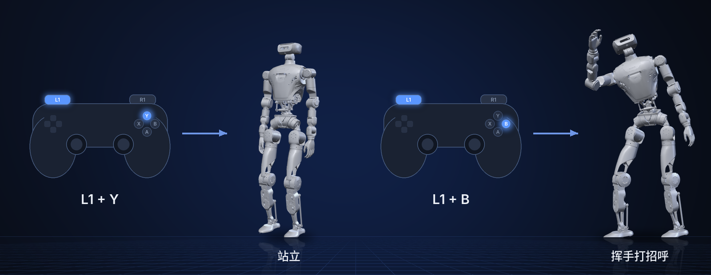
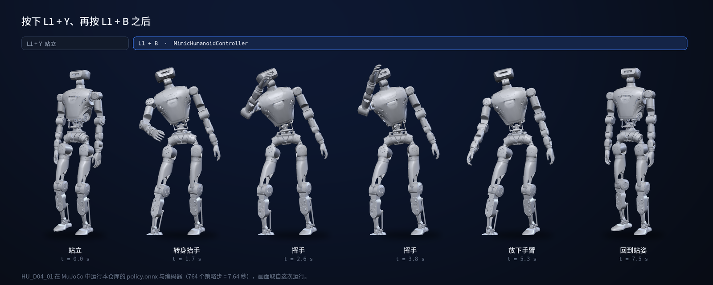
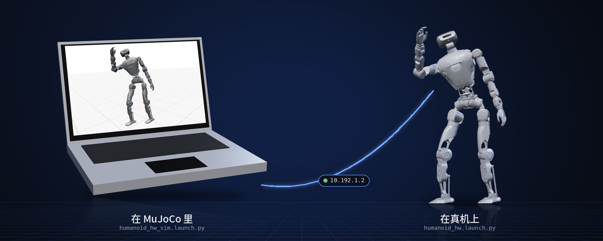

<p align="center">
  
</p>

<p align="center">
  <a href="README.md">English</a> | <b>中文</b>
</p>

<p align="center">
  <a href="LICENSE"></a>
  
  
  
</p>

# humanoid-rl-deploy-ros2

用 ROS 2 和 `ros2_control` 把强化学习策略部署到 LimX 人形机器人上：同一份编译产物既能在
MuJoCo 仿真里跑，也能在真机上跑，用遥控器在站立和策略之间切换。

> **范围：** 只负责 ROS 2 部署端，包含硬件节点、三个控制器和一个示例策略（打招呼动作，
> ONNX 格式）。策略训练不在本仓库；仿真器见
> [humanoid-mujoco-sim](https://github.com/limxdynamics/humanoid-mujoco-sim)。

## 亮点

- **仿真和真机同一份编译。** 两个 launch 文件只差机器人地址：MuJoCo 用 `127.0.0.1`，真机用 `10.192.1.2`。
- **ONNX 策略，运行时不需要 Python。** C++ 中用 ONNX Runtime 推理：一个策略加两个编码器，
  在 1 kHz 控制循环里以 100 Hz 运行。
- **遥控器切换控制器。** `L1 + Y` 站立，`L1 + B` 执行策略，`L1 + A` 切到阻尼。
- **控制器内置安全限幅。** 每个关节目标都会被裁剪，保证 PD 力矩不超过该关节力矩上限的 95%。
- **标准 `ros2_control` 插件。** 控制器通过 pluginlib 加载，新增控制器只需一个类和配置里的一行。

## 支持的机器人

| | 型号 | 说明 | 自由度 | 格式 |
|:-:|---|---|:-:|---|
|  | `HU_D04_01` | 全尺寸人形：双腿、3 自由度腰、2 自由度头、7 自由度手臂 | 31 | ONNX 策略 + YAML |
|  | `HU_D03_03` | 上一代，已停产（[humanoid-description](https://github.com/limxdynamics/humanoid-description)） | 31 | ONNX 策略 + YAML |

用 `ROBOT_TYPE` 选择型号（见 [创建工作空间](#2-创建工作空间)）。

## 效果

<p align="center">
  
</p>

<p align="center">
  
</p>

<p align="center">
  
</p>

## 快速开始

在已安装 ROS 2 Humble 和 ONNX Runtime（见 [第 1 节](#1-部署环境配置)）的 Ubuntu 22.04 上先跑仿真：

```bash
mkdir -p ~/limx_ws && cd ~/limx_ws
git clone --recurse https://github.com/limxdynamics/humanoid-mujoco-sim.git
git clone --recurse https://github.com/limxdynamics/humanoid-rl-deploy-ros2.git
echo 'export ROBOT_TYPE=HU_D04_01' >> ~/.bashrc && source ~/.bashrc

# 终端 1：仿真器
pip install humanoid-mujoco-sim/limxsdk-lowlevel/python3/amd64/limxsdk-*.whl
python humanoid-mujoco-sim/simulator.py

# 终端 2：控制器
conda deactivate   # 装了 Conda 要先退出，它会覆盖 ROS 的环境设置
source /opt/ros/humble/setup.bash
cd ~/limx_ws/humanoid-rl-deploy-ros2
colcon build --cmake-args -DCMAKE_BUILD_TYPE=Release
source install/setup.bash
ros2 launch robot_hw humanoid_hw_sim.launch.py
```

然后启动虚拟遥控器（`~/limx_ws/humanoid-mujoco-sim/robot-joystick/robot-joystick`），
先按 `L1 + Y`，再按 `L1 + B`。

## 1. 部署环境配置

- **安装 ROS 2 Humble**（Ubuntu 22.04）。按
  https://docs.ros.org/en/humble/Installation/Ubuntu-Install-Debians.html 的说明安装，选择
  `ros-humble-desktop`。装完后在 Bash 终端执行下面的命令，安装编译所需的库：

    ```bash
    sudo apt update
    sudo apt install ros-humble-urdf \
                ros-humble-urdfdom \
                ros-humble-urdfdom-headers \
                ros-humble-kdl-parser \
                ros-humble-hardware-interface \
                ros-humble-controller-manager \
                ros-humble-controller-interface \
                ros-humble-controller-manager-msgs \
                ros-humble-control-msgs \
                ros-humble-gazebo-* \
                ros-humble-rviz* \
                ros-humble-rqt-gui \
                ros-humble-rqt-robot-steering \
                ros-humble-plotjuggler* \
                ros-humble-control-toolbox \
                ros-humble-ros2-control \
                ros-humble-ros2-controllers \
                ros-dev-tools \
                cmake build-essential libpcl-dev libeigen3-dev libopencv-dev libmatio-dev \
                python3-pip libboost-all-dev libtbb-dev liburdfdom-dev liborocos-kdl-dev \
                tree -y
    ```

- **安装 ONNX Runtime。** 从
  https://github.com/microsoft/onnxruntime/releases/tag/v1.10.0 下载对应平台的版本。
  Ubuntu 22.04 x86_64 按下面步骤：

    ```bash
    wget https://github.com/microsoft/onnxruntime/releases/download/v1.10.0/onnxruntime-linux-x64-1.10.0.tgz

    tar xvf onnxruntime-linux-x64-1.10.0.tgz

    sudo cp -a onnxruntime-linux-x64-1.10.0/include/* /usr/include
    sudo cp -a onnxruntime-linux-x64-1.10.0/lib/* /usr/lib
    ```

## 2. 创建工作空间

- 创建一个目录存放工作空间，例如用户主目录下的 `limx_ws`：

  ```bash
  mkdir -p ~/limx_ws
  ```

- 下载 MuJoCo 仿真器：

  ```bash
  cd ~/limx_ws

  # Option 1: HTTPS
  git clone --recurse https://github.com/limxdynamics/humanoid-mujoco-sim.git

  # Option 2: SSH
  git clone --recurse git@github.com:limxdynamics/humanoid-mujoco-sim.git
  ```

- 下载运动控制算法：

  ```bash
  cd ~/limx_ws

  # Option 1: HTTPS
  git clone --recurse https://github.com/limxdynamics/humanoid-rl-deploy-ros2.git

  # Option 2: SSH
  git clone --recurse git@github.com:limxdynamics/humanoid-rl-deploy-ros2.git
  ```

- 设置机器人型号：如果尚未设置，请按照以下步骤进行设置。

  - 通过 Shell 命令 `tree -L 1 humanoid-rl-deploy-ros2/robot_controllers/config` 列出可用的机器人类型：

    ```bash
    cd ~/limx_ws/humanoid-rl-deploy-ros2/src
    tree -L 1 humanoid-rl-deploy-ros2/robot_controllers/config
    ```

    输出：

    ```text
    humanoid-rl-deploy-ros2/robot_controllers/config
    ├── HU_D03_03
    └── HU_D04_01
    ```

  - 以`HU_D04_01`（请根据实际机器人类型进行替换）为例，设置机器人型号类型：

    ```bash
    echo 'export ROBOT_TYPE=HU_D04_01' >> ~/.bashrc && source ~/.bashrc
    ```

### 编译与运行前

第 3、4 节的编译和启动要在多个终端里进行。**每开一个新终端都先执行下面两行**，
这两节的命令块里不再重复。

```bash
# 如您安装了 Conda，请先退出：它会覆盖 ROS 的环境设置
conda deactivate

# 设置 ROS 环境
source /opt/ros/humble/setup.bash
```

## 3. 仿真调试

- 运行 MuJoCo 仿真器（推荐 Python 3.8 及以上版本）

  - 打开一个 Bash 终端。

  - 安装运动控制开发库：

    - Linux x86_64 环境

      ```bash
      cd ~/limx_ws
      pip install humanoid-mujoco-sim/limxsdk-lowlevel/python3/amd64/limxsdk-*.whl
      ```

    - Linux aarch64 环境

      ```bash
      cd ~/limx_ws
      pip install humanoid-mujoco-sim/limxsdk-lowlevel/python3/aarch64/limxsdk-*.whl
      ```

  - 运行 MuJoCo 仿真器：

    ```bash
    cd ~/limx_ws
    python humanoid-mujoco-sim/simulator.py
    ```

- 运行算法

  - 打开一个 Bash 终端。

  - 请进入您的工作空间完成编译：

    ```bash
    cd ~/limx_ws/humanoid-rl-deploy-ros2
    colcon build --cmake-args -DCMAKE_BUILD_TYPE=Release
    ```

  - 启动

    ```bash
    cd ~/limx_ws/humanoid-rl-deploy-ros2
    source install/setup.bash
    ros2 launch robot_hw humanoid_hw_sim.launch.py
    ```

    

- 虚拟遥控器：在仿真里用它驱动机器人。

  - 打开一个 Bash 终端。

  - 运行：

    ```bash
    ~/limx_ws/humanoid-mujoco-sim/robot-joystick/robot-joystick
    ```

    

  - 按键操作如下：

    | **按键** | **模式**         | **说明**                                                    |
    | -------- | ---------------- | ----------------------------------------------------------- |
    | L1+Y     | 切换到站立模式   | 如机器人没法站立，请点击 MuJoCo 界面中的“Reset”进行复位一下。 |
    | L1+B     | 切换到打招呼模式 |                                                             |

## 4. 真机调试

- 设置电脑 IP：用网线把电脑接到机器人的外置网口，把电脑 IP 设为 `10.192.1.200`，确认
  `ping 10.192.1.2` 能通。IP 设置如下图所示：

  

- 算法编译：

  ```bash
  cd ~/limx_ws/humanoid-rl-deploy-ros2
  colcon build --cmake-args -DCMAKE_BUILD_TYPE=Release
  ```

- 机器人准备工作：

  - 请通过机器人左右肩膀的挂钩把机器人吊起来。
  - 按电源键开机后，按下遥控器`右摇杆`按键，启动机器人电机。
  - 按下遥控器按键 `R1 + DOWN`切换到开发者模式。在此模式下，用户可以开发自己的运动控制算法。（此模式设置后，下次开机继续生效，如需退出开发者模式请按`R1 + LEFT`退出）。

- 真机部署运行：

  ```bash
  cd ~/limx_ws/humanoid-rl-deploy-ros2
  source install/setup.bash
  ros2 launch robot_hw humanoid_hw.launch.py
  ```

- 这时您可以通过遥控器按键`L1 + △`让机器人进入站立模式。

- 遥控器按`L1 + 〇`控制机器人打招呼。

## 5. 控制器与遥控器

`robot_hw_node` 运行 1 kHz 循环和 `controller_manager`，根据遥控器按键切换控制器
（`robot_hw/src/HumanoidHardwareNode.cpp`）：

| 按键 | 控制器 | 作用 |
|---|---|---|
| `L1 + Y` | `StandHumanoidController` | 以 `stand_kp` / `stand_kd` 从当前姿态过渡到 `stand_pos` |
| `L1 + B` | `MimicHumanoidController` | 运行 ONNX 策略（打招呼动作） |
| `L1 + A` | `DampingHumanoidController` | 所有关节只加阻尼（`damping_kd`） |
| `L1 + X` | 停止 `DampingHumanoidController` | |

机器人自带遥控器上，Y 和 B 对应 `△` 和 `〇`。机器人报告 EtherCAT 或 IMU 错误时，也会自动停止
`DampingHumanoidController`。

## 6. 部署自己的策略

`MimicHumanoidController` 从 `robot_controllers/config/$ROBOT_TYPE/mimic/policy/` 加载三个
ONNX 文件，参数来自同级的 `mimic/params.yaml`。每 10 个控制周期（100 Hz）：

1. 组装 100 维观测：机体角速度（x 0.25）、重力投影、31 个关节位置、31 个关节速度（x 0.05）、
   上一步动作、动作相位（`step / motion_frames`）。
2. 保留最近 10 帧观测（1000 维），送入 `lin_encoder.onnx`（输出 3 维）和
   `priv_encoder.onnx`（输出 32 维）。
3. `policy.onnx` 输入观测、3 维指令（本控制器中为零）和两个编码器输出，共 138 维，输出 31 维动作。
4. 每个关节目标为 `action x action_scale`，按 `kp` / `kd` 下发。

若要部署接口相同的其他策略，替换这三个文件并更新 `params.yaml`（`motion_frames`、`action_scale`、
`kp`、`kd`、力矩上限），然后重新 `colcon build`，让 `install/` 下的副本同步更新。
关节顺序为：双腿（左、右）、腰、头、左臂、右臂。

## 许可证

Apache License 2.0，见 [LICENSE](LICENSE) 和 [NOTICE](NOTICE)。
